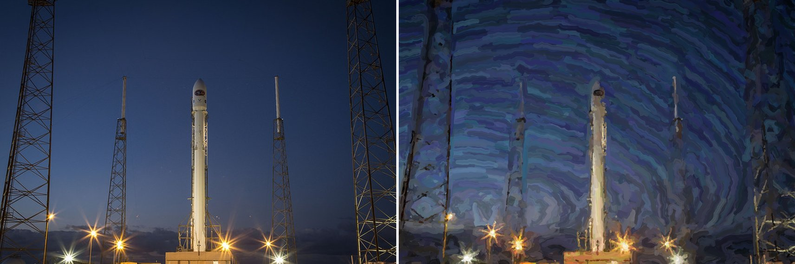
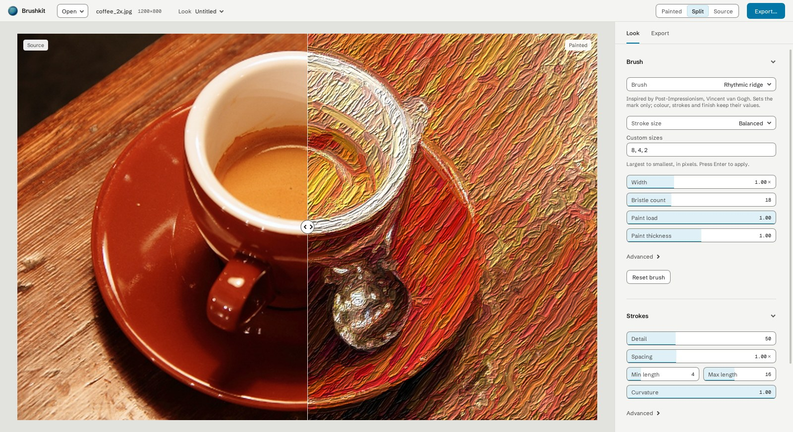
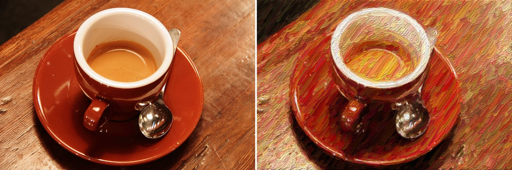

  

<h1 align="center">Paintify</h1>

  <b>Turn your photos and videos into paintings.</b> 
  Real brush strokes, placed one at a time. No AI, no neural networks.

  <a href="https://github.com/BrownBearr/paintify-GPU/releases/latest"><b>Download for Mac</b></a>
  &nbsp;·&nbsp;
  <a href="https://github.com/BrownBearr/paintify-GPU/releases/latest"><b>Download for Windows</b></a>

  

## Painting, not filtering

Paintify doesn't run your image through a style-transfer model, and it doesn't ask a server to guess what a painting should look like. It paints. It studies your picture, decides where a stroke is needed, follows the shapes and edges with a brush, and lays paint down stroke by stroke, coarse to fine, the way a painter blocks in a canvas and then works up the detail.

Every result is made of strokes you can control, so the same photo can become a loose wash or a dense, ridged impasto with a few slider moves. Because it's pure code running on your graphics card, it's fast, private, and gives the same painting every time.

  

## Video too

Drop in a clip and Paintify paints every frame. Watch it play back painted in real time, then export the finished video.

  

## Pick a brush

Choose from more than twenty brushes inspired by the history of painting: Van Gogh's rhythmic ridges, Monet's broken colour, Seurat's dots, Cézanne's flat hatching, a palette knife, watercolour, ukiyo-e, sumi-e and more. A brush changes the shape and texture of every mark, while the colours stay true to your image.

  

## How it works

1. **Download** Paintify for Mac or Windows and open it.
2. **Import** an image, a video, or a whole folder of images. Drag and drop works too.
3. **Shape the look.** Pick a brush, then adjust stroke size, length, curvature, paint thickness and lighting until it looks right. A split view shows the original and the painting side by side as you work.
4. **Export** a PNG, a batch of paintings, or a painted video.

  

  

## What you get

- **Live preview.** Every change repaints in a moment, right on your graphics card.
- **Your colours, your composition.** Paintify adds the brushwork and leaves the picture yours.
- **Paint you can see.** Raised paint catches the light, with adjustable thickness and light direction.
- **Steady video.** Strokes stay put where nothing moves, so footage doesn't flicker.
- **Save your looks.** Store a set of brush and stroke settings and reuse it on any image.
- **Batch mode.** Paint a whole folder in one go.
- **Made for each platform.** A real Mac app on Apple silicon and Intel with a native menu bar, trackpad pinch and Retina display, and a native Windows app.

## Download

| | |
|---|---|
| **Mac** (macOS 12 or later) | [Apple silicon DMG](https://github.com/BrownBearr/paintify-GPU/releases/latest) · [Intel DMG](https://github.com/BrownBearr/paintify-GPU/releases/latest) |
| **Windows** (10 or 11, 64-bit) | [Windows ZIP](https://github.com/BrownBearr/paintify-GPU/releases/latest) |

**Mac:** open the DMG and drag the app into Applications. The first time you launch it, right-click the app and choose **Open** (on macOS 15 and later, use **System Settings > Privacy & Security > Open Anyway**). This is needed once, because the app isn't yet registered with Apple.

**Windows:** unzip the folder anywhere and double-click `run.bat`. If Windows SmartScreen appears, choose **More info > Run anyway**.

**Video** import and export also need ffmpeg, a free video tool: on a Mac run `brew install ffmpeg`, on Windows [download it](https://ffmpeg.org/download.html) and add it to your PATH. Still images work without it.

---

Built on Hertzmann's painterly rendering, ported from <a href="https://github.com/BrownBearr/PainterlyImageCreatorWeb">PainterlyImageCreatorWeb</a> to the GPU. Developers: see <a href="docs/BUILDING.md">building from source and the command line</a>. Example photos: Chelsea the cat (Stefan van der Walt) and espresso cup (Rachel Michetti), both CC0; Falcon 9 launch (SpaceX), public domain.
